# Gemini 4 Argon — Project Showcase & Prompt Anthology

A curated collection of **21 interactive 3D simulations, native macOS & iOS apps, AI creative studios, procedural Blender/Python video pipelines, and cultural digital archives** built with **Gemini 4 Argon**.

Each project entry below includes a **short overview**, a **live screenshot**, and a **two-line prompt** you can use to recreate the project from scratch.

---

## Table of Contents

1. [3D KLCC Drone Flyover (`3d-klcc-blender`)](#1-3d-klcc-drone-flyover-3d-klcc-blender)
2. [Gemini 4 Argon API Tester (`argon-tester`)](#2-gemini-4-argon-api-tester-argon-tester)
3. [Spielhaus TTDI — European Board Game Parlor (`board-game-ttdi`)](#3-spielhaus-ttdi--european-board-game-parlor-board-game-ttdi)
4. [3D Chinese Chess / Xiangqi (`chess-board`)](#4-3d-chinese-chess--xiangqi-chess-board)
5. [KLCC Rail Ops — 3D LRT & MRT Simulator (`chess-board/klcc-train-sim`)](#5-klcc-rail-ops--3d-lrt--mrt-simulator-chess-boardklcc-train-sim)
6. [Satu Lorong TTDI — iOS Coffee & Curbside App (`coffee-app`)](#6-satu-lorong-ttdi--ios-coffee--curbside-app-coffee-app)
7. [Argon Atelier — AI Coloring Studio (`coloring`)](#7-argon-atelier--ai-coloring-studio-coloring)
8. [Desktop Racer 3D — Isometric Sit-Stand Desk GP (`desktop-racer-3d`)](#8-desktop-racer-3d--isometric-sit-stand-desk-gp-desktop-racer-3d)
9. [TT Racing Desktop GP — 1st-Person Cockpit POV (`desktop-racer-3d-fps`)](#9-tt-racing-desktop-gp--1st-person-cockpit-pov-desktop-racer-3d-fps)
10. [The History of Dinosaurs — 60s Procedural Documentary (`dinosaur`)](#10-the-history-of-dinosaurs--60s-procedural-documentary-dinosaur)
11. [iPhone 18 Pro Max — 3D Exploded CAD Teardown (`exploded iphone 18 pro max`)](#11-iphone-18-pro-max--3d-exploded-cad-teardown-exploded-iphone-18-pro-max)
12. [GummyBox — Soft-Body Jelly Bear Playground (`gummy-bear`)](#12-gummybox--soft-body-jelly-bear-playground-gummy-bear)
13. [HandCraft Puzzle — Webcam Gesture Photo Puzzle (`hand-puzzle`)](#13-handcraft-puzzle--webcam-gesture-photo-puzzle-hand-puzzle)
14. [How Money Works — 60s Cartoon Explainer (`how-money-works-explainer`)](#14-how-money-works--60s-cartoon-explainer-how-money-works-explainer)
15. [What Is National Debt? — Whiteboard Explainer (`national-debt-explainer`)](#15-what-is-national-debt--whiteboard-explainer-national-debt-explainer)
16. [Panda Cycling in Kuala Lumpur (`panda cycling`)](#16-panda-cycling-in-kuala-lumpur-panda-cycling)
17. [Galeri Proton — National Automotive Archive & 3D Museum (`proton-museum`)](#17-galeri-proton--national-automotive-archive--3d-museum-proton-museum)
18. [ScreenStudio for macOS — Native Swift Screen Recorder (`screen_recorder`)](#18-screenstudio-for-macos--native-swift-screen-recorder-screen_recorder)
19. [SSStudio — Screen Studio Architecture Reconstruction (`screenstudio-rea`)](#19-ssstudio--screen-studio-architecture-reconstruction-screenstudio-rea)
20. [Moyun Shufa (墨韵) — Chinese Calligraphy Studio (`shufa`)](#20-moyun-shufa-墨韵--chinese-calligraphy-studio-shufa)
21. [What Is GDP? ("Huge If True" Edition) (`what-is-gdp`)](#21-what-is-gdp-huge-if-true-edition-what-is-gdp)

---

## 1. 3D KLCC Drone Flyover ([`3d-klcc-blender`](./3d-klcc-blender))

**Tech Stack:** `Blender 5.2 LTS` · `Python (bpy / bmesh)` · `EEVEE Raytracing`

**Short Description:**
A procedural Python script for Blender that generates and renders a 10-second (240-frame) 3D drone flyover of Kuala Lumpur City Centre (KLCC). It constructs the Petronas Twin Towers with authentic 8-pointed *Rub el Hizb* geometric floor plates, the double-deck Skybridge, Suria KLCC Esplanade, Symphony Lake fountains, and a quadcopter drone with spinning propellers following a cinematic Bezier flight path.

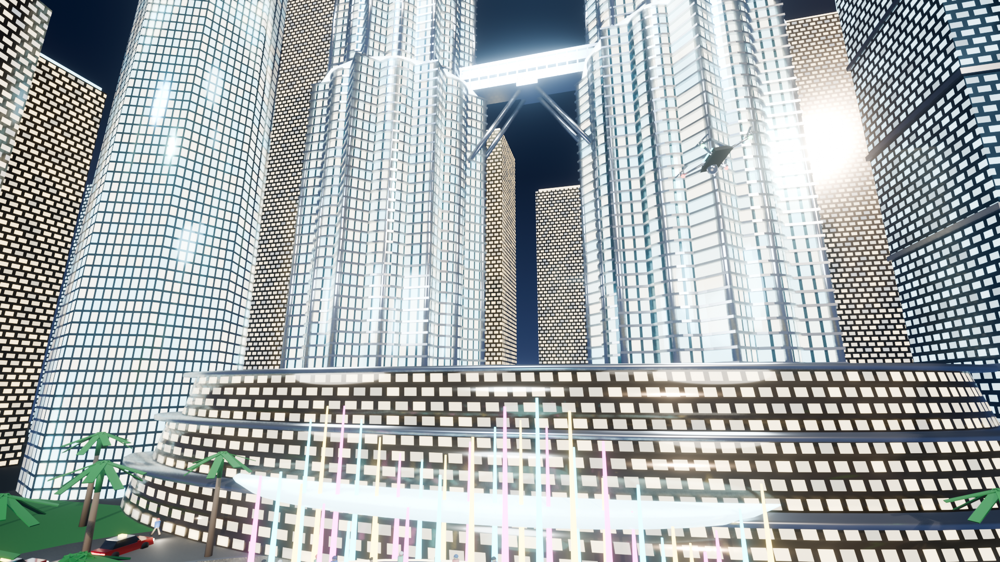

**2-Line Build Prompt:**
```text
Write a self-contained Blender Python script (bpy/bmesh) that procedurally models the Petronas Twin Towers with authentic 8-pointed Rub el Hizb star geometry, the double-deck Skybridge, Suria KLCC park, and a surrounding city skyline with illuminated windows.
Animate a 10-second 24fps quadcopter drone flyover weaving through the towers at dusk using EEVEE raytracing and bloom, and render both preview keyframes and a 1080p MP4 video.
```

---

## 2. Gemini 4 Argon API Tester ([`argon-tester`](./argon-tester))

**Tech Stack:** `HTML5` · `CSS3` · `Vanilla JavaScript` · `OpenAI-Compatible Streaming SSE`

**Short Description:**
A sleek, dark-mode developer workbench and chat playground for testing the `gemini-4-argon` model via an OpenAI-compatible API endpoint. It supports real-time streaming responses, multimodal image attachments, adjustable temperature and system instructions, syntax-highlighted Markdown code blocks, and one-click reasoning/coding benchmark prompts.

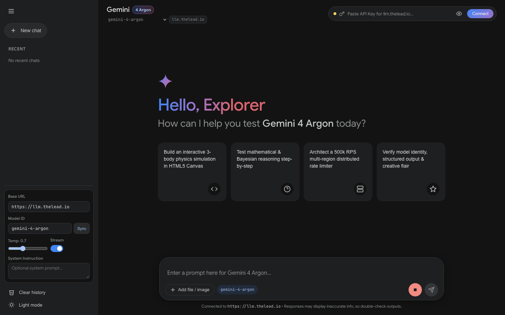

**2-Line Build Prompt:**
```text
Build a dark-mode web playground for testing the Gemini 4 Argon API with configurable base URL, API key, model selector, temperature slider, system prompt, and multimodal file/image uploads.
Include real-time SSE token streaming, Markdown and syntax-highlighted code rendering, persistent local chat history, and starter benchmark cards for physics, math, and system design.
```

---

## 3. Spielhaus TTDI — European Board Game Parlor ([`board-game-ttdi`](./board-game-ttdi))

**Tech Stack:** `HTML5` · `Editorial CSS` · `Vanilla JavaScript`

**Short Description:**
An editorial web experience and digital archive for *Spielhaus TTDI*, a European board game parlor and retail atelier in Taman Tun Dr Ismail, Kuala Lumpur. Styled like a tactile German *Kennerspiel* manual, it features an interactive 485+ Eurogame vault filter, annotated tabletop photography pins, a "Spielberater" game flight recommender, and live green-baize table reservations.

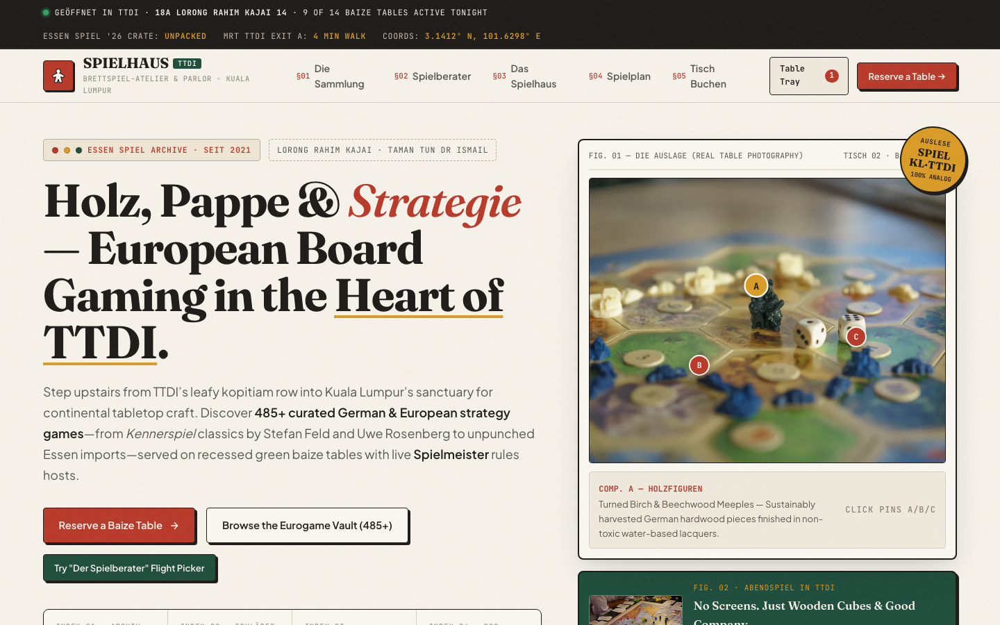

**2-Line Build Prompt:**
```text
Design an editorial, tactile European board game parlor website for "Spielhaus TTDI" in Kuala Lumpur using warm archival paper tones, literary serif typography, and interactive tabletop component hotspots.
Include a searchable Eurogame vault filterable by player count and BGG weight, an interactive "Spielberater" game recommender quiz, and a live baize-table reservation drawer.
```

---

## 4. 3D Chinese Chess / Xiangqi ([`chess-board`](./chess-board))

**Tech Stack:** `Three.js` · `Vite` · `Web Audio API` · `Minimax Alpha-Beta AI`

**Short Description:**
A full-viewport 3D Chinese Chess (*Xiangqi* / 楚漢爭霸) game built with Three.js. Players can switch between bespoke 3D cartoon figurine pieces (generals, cannons, war elephants, chariots, horses) and traditional carved wooden discs across rosewood or jade boards, complete with a multi-level AI engine (Novice, Club, Master), classic endgame puzzles, legal move indicators, and synthesized percussion audio.

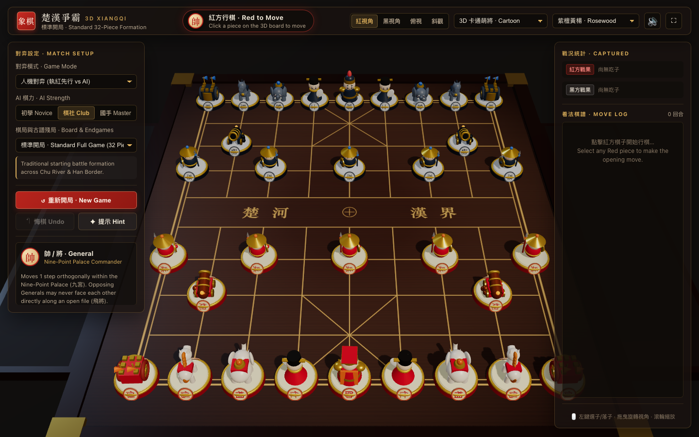

**2-Line Build Prompt:**
```text
Build a 3D Chinese Chess (Xiangqi) web game in Three.js featuring toggleable 3D cartoon character figurines and traditional engraved wooden pieces on an interactive rosewood board with Chu River and Han Border markings.
Implement full Xiangqi rules (including horse-leg blocking, elephant-eye blocking, cannon jumping, and flying generals), an alpha-beta pruning AI with three difficulty levels, classic endgame presets, and camera view presets.
```

---

## 5. KLCC Rail Ops — 3D LRT & MRT Simulator ([`chess-board/klcc-train-sim`](./chess-board/klcc-train-sim))

**Tech Stack:** `Three.js` · `Vite` · `CBTC Telemetry Simulation`

**Short Description:**
A 3D urban rail transit and cab telemetry simulator modeling Kuala Lumpur's Kelana Jaya Line LRT (Bombardier Innovia Metro 300) and Putrajaya Line MRT around the KLCC Twin Towers corridor. It features CBTC Moving-Block ATO automation as well as manual master-controller traction/braking notches, 5 camera views (Orbit, Cab POV, Chase, Platform, Saloma Link), real-time speed/traction graphs, and station dwell/PSD door operations.

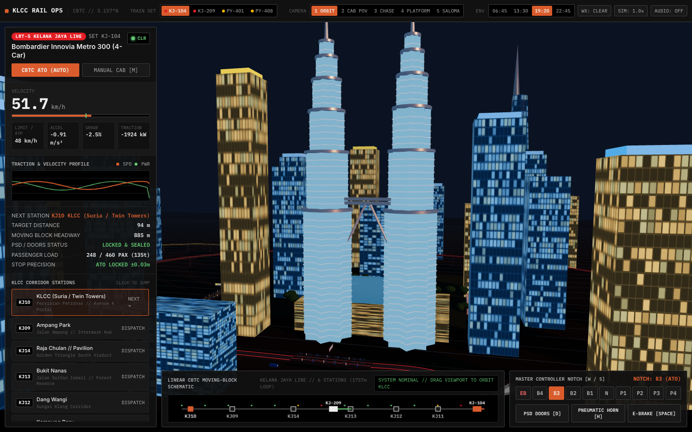

**2-Line Build Prompt:**
```text
Create a 3D Kuala Lumpur rail transit simulator in Three.js showcasing Kelana Jaya LRT and Putrajaya MRT trains running along elevated viaducts and underground portals around the illuminated Petronas Twin Towers.
Include a live CBTC telemetry HUD with velocity/traction curves, a linear moving-block station schematic, toggleable ATO auto-drive vs. manual traction/brake notch controls, and multiple camera angles including Driver Cab POV.
```

---

## 6. Satu Lorong TTDI — iOS Coffee & Curbside App ([`coffee-app`](./coffee-app))

**Tech Stack:** `React` · `TypeScript` · `Vite` · `SwiftUI Native iOS Target`

**Short Description:**
A flagship mobile ordering experience (with both an interactive iOS simulator web preview and a native Xcode SwiftUI project) for *Satu Lorong*, a specialty coffee and sourdough roastery in TTDI, Kuala Lumpur. Built around TTDI's street culture, it features "Lorong 14 Double-Park Express" curbside runner delivery with license-plate hazard beacon triggers, live La Marzocco KB90 espresso telemetry in the iPhone Dynamic Island, and custom drink/pastry pairing builders.

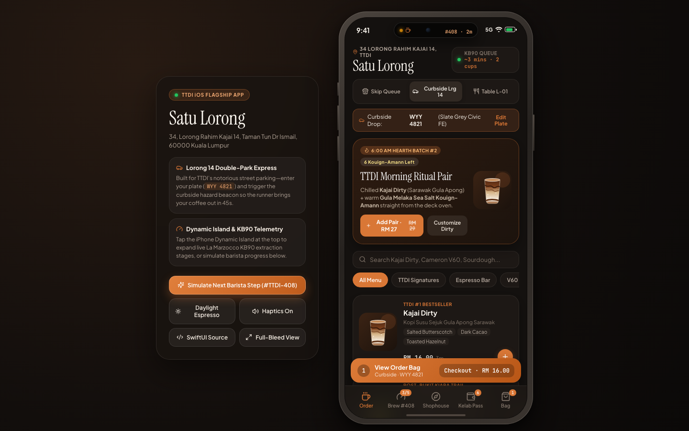

**2-Line Build Prompt:**
```text
Build a specialty coffee & sourdough roastery iOS app for "Satu Lorong TTDI" featuring a warm espresso-toned UI, interactive iPhone Dynamic Island live brew telemetry, and a "Double-Park Curbside Express" mode with car plate recognition.
Provide both a responsive interactive iPhone showcase with live barista step simulation and a companion native SwiftUI source viewer, menu customizer, loyalty pass, and checkout flow.
```

---

## 7. Argon Atelier — AI Coloring Studio ([`coloring`](./coloring))

**Tech Stack:** `Vite` · `HTML5 Canvas` · `Flood-Fill Segmentation` · `Gemini 4 Argon Vision`

**Short Description:**
An interactive digital coloring book and AI-assisted painting studio. Users can upload any black-and-white line art (or convert photos to line art), automatically segment enclosed regions with scanline flood-fill, and either paint manually with stay-in-lines brushes/watercolor washes or let Gemini 4 Argon Vision automatically plan and animate a region-by-region color palette (e.g., Ghibli Gouache, Risograph, Pastel Dreamscape).

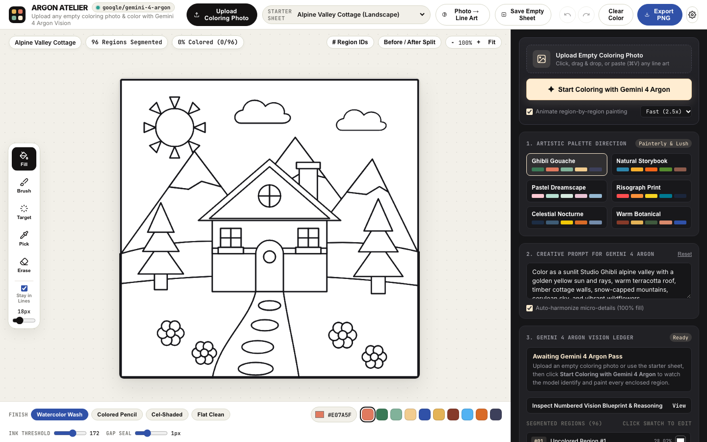

**2-Line Build Prompt:**
```text
Create an interactive AI coloring studio in HTML5 Canvas that segments uploaded black-and-white line art into enclosed regions and lets users paint with stay-in-lines brush, bucket fill, watercolor, and colored-pencil textures.
Integrate a Gemini 4 Argon Vision coloring engine that numbers every segmented region, reasons over artistic palette presets and creative prompts, and animates region-by-region painting with a before/after split comparator.
```

---

## 8. Desktop Racer 3D — Isometric Sit-Stand Desk GP ([`desktop-racer-3d`](./desktop-racer-3d))

**Tech Stack:** `Three.js` · `Vite` · `Custom Arcade Vehicle Physics`

**Short Description:**
A stylized isometric 3D micro-car racing game set atop a motorized height-adjustable sit-stand desk workspace. Players drift a miniature GT racer around dual coding monitors, mechanical keyboards, coffee mugs, notebooks, and smartphones while adjusting the real-time physical desk height (75cm sit to 120cm stand) and competing for 3-lap personal bests.

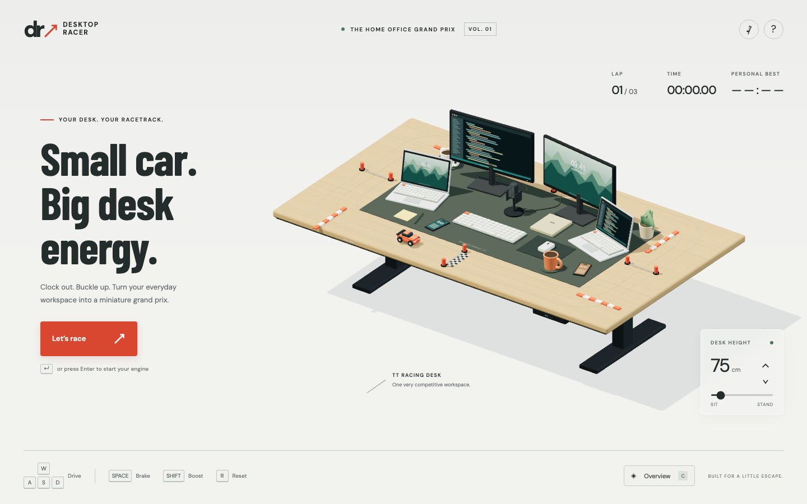

**2-Line Build Prompt:**
```text
Build an isometric 3D micro-car racing game in Three.js where a miniature sports car races across a detailed motorized sit-stand desk cluttered with laptops, dual monitors, keyboards, and coffee mugs.
Include arcade drift/boost vehicle physics, a 3-lap timer with checkpoint gates, camera view toggles, and an interactive desk-height controller that raises and lowers the 3D table during gameplay.
```

---

## 9. TT Racing Desktop GP — 1st-Person Cockpit POV ([`desktop-racer-3d-fps`](./desktop-racer-3d-fps))

**Tech Stack:** `Three.js` · `ES Modules` · `Web Audio Engine`

**Short Description:**
A first-person cockpit POV 3D racing game on a motorized TT Racing sit-stand desk. Players sit inside a detailed supercar cockpit complete with an animated steering wheel, digital RPM/speedometer dash, rearview mirror, and windshield HUD, threading between towering dual monitors, launching off laptop keyboard ramps, racing AI opponents, and triggering dynamic wave motion on the motorized desk.

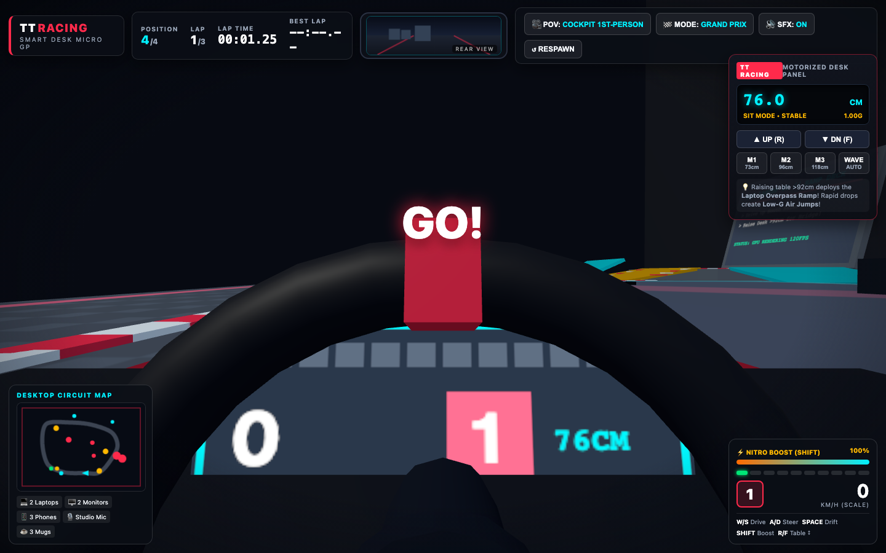

**2-Line Build Prompt:**
```text
Create a first-person cockpit POV 3D racing game in Three.js set on a giant motorized sit-stand desk, featuring an interior steering wheel, live digital dashboard telemetry, rearview mirror, and AI rival cars.
Design a circuit weaving around oversized monitors, coffee mugs, and keyboard ramps, with nitro boost, handbrake drifting, synthesized engine audio, and live controls to raise, lower, or wave-oscillate the desk height.
```

---

## 10. The History of Dinosaurs — 60s Procedural Documentary ([`dinosaur`](./dinosaur))

**Tech Stack:** `Python` · `Pillow / OpenCV` · `Catmull-Rom Spline Rigs` · `FFmpeg`

**Short Description:**
A 100% code-generated 60-second 1080p animated documentary (*恐龙简史 · The History of Dinosaurs*) spanning 252 million years across 6 acts: Triassic dawn (*Coelophysis*), Jurassic giants (*Brachiosaurus* & *Stegosaurus*), Cretaceous apex predators (*T. rex* & *Triceratops*), the 66 Ma Chicxulub asteroid impact, fossil stratigraphy, and the evolution of feathered theropods into modern birds.

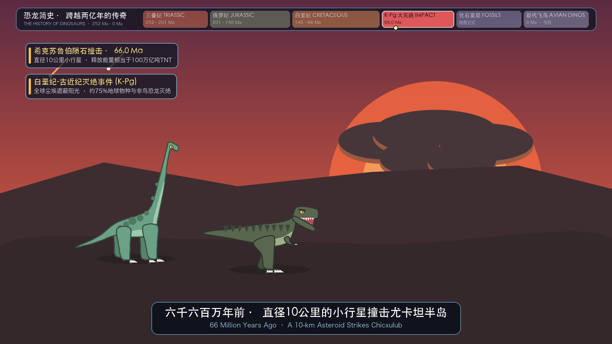

**2-Line Build Prompt:**
```text
Write a Python video generation pipeline using Pillow, NumPy, and FFmpeg that procedurally rigs and animates a 60-second, 1080p @ 30fps Kurzgesagt-style documentary on the history of dinosaurs across six geological acts.
Use Catmull-Rom splines for articulated dinosaur locomotion (Coelophysis, Brachiosaurus, Stegosaurus, T. rex, Triceratops, Pterosaur, and modern birds), bilingual timeline HUD overlays, and synchronized narration/soundtrack synthesis.
```

---

## 11. iPhone 18 Pro Max — 3D Exploded CAD Teardown ([`exploded iphone 18 pro max`](./exploded%20iphone%2018%20pro%20max))

**Tech Stack:** `Three.js` · `Procedural PBR Materials` · `Interactive CAD HUD`

**Short Description:**
An interactive 3D architectural teardown and CAD engineering showcase of a conceptual iPhone 18 Pro Max. Users can scrub an explosion slider from `0% Sealed` to `140% Deep CAD` across three explosion vectors (Axial Z-Stack, 3D Radial Burst, Isometric Cascade) to inspect 10 internal hardware layers—including the Super Retina XDR OLED, A20 Pro 2nm logic board, tetraprism camera array, copper vapor chamber, L-shaped steel battery, and Grade 5 titanium unibody—with X-Ray and Thermal vision modes.

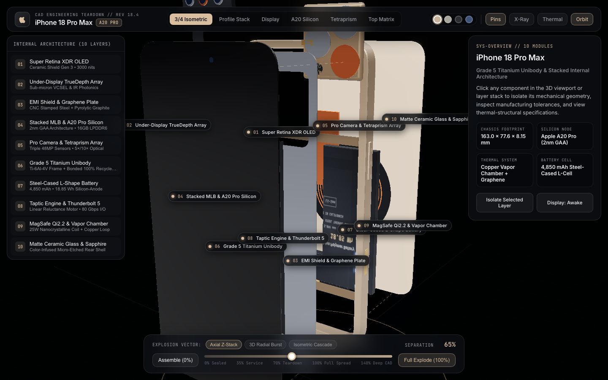

**2-Line Build Prompt:**
```text
Build an interactive 3D exploded hardware teardown of the iPhone 18 Pro Max in Three.js featuring 10 precision-modeled internal layers including the OLED display, A20 Pro logic board, tetraprism camera module, MagSafe coil, steel L-battery, and titanium chassis.
Include a continuous explosion slider, three explosion vector modes (Axial, Radial, Isometric), clickable 3D callout pins, layer isolation, finish switchers, and X-Ray/Thermal shader modes.
```

---

## 12. GummyBox — Soft-Body Jelly Bear Playground ([`gummy-bear`](./gummy-bear))

**Tech Stack:** `HTML5 Canvas` · `Spring-Mass Soft-Body Physics` · `Web Audio Synthesizer`

**Short Description:**
A 60 FPS interactive soft-body physics sandbox filled with squishy, translucent gummy bears. Each bear is simulated as a spring-mass pressure-volume mesh that wobbles, stretches, bounces, and collides realistically. Users can stretch ears and paws, boop, take chomps out of bears, swirl them in a vortex, pump them up to giant size, toggle Zero-G or Candy Rain, and customize flavors and finishes (Glossy, Sour Sugar, Neon Glow).

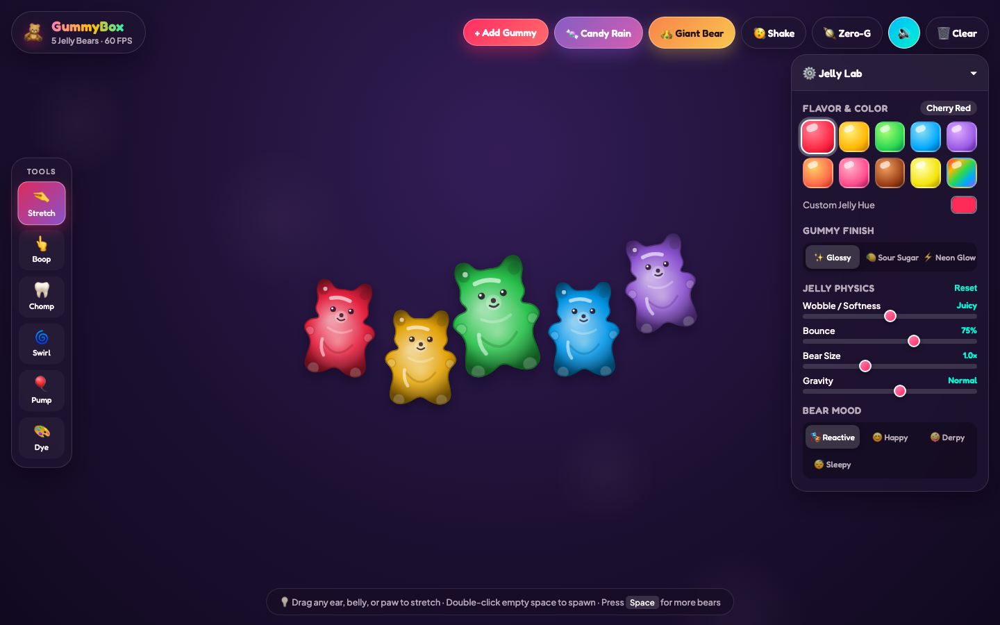

**2-Line Build Prompt:**
```text
Create a 60 FPS interactive 2D soft-body physics playground in HTML5 Canvas where colorful, translucent gummy bears deform, wobble, and bounce using a spring-mass and internal pressure simulation.
Add interactive tools to stretch limbs, boop, bite/chomp chunks, inflate, and dye bears, alongside controls for wobble stiffness, gravity, flavor colors, sour-sugar/neon finishes, and procedural squishy sound effects.
```

---

## 13. HandCraft Puzzle — Webcam Gesture Photo Puzzle ([`hand-puzzle`](./hand-puzzle))

**Tech Stack:** `MediaPipe Hands` · `HTML5 Canvas` · `Vanilla JavaScript` · `Web Audio API`

**Short Description:**
A gesture-controlled photo tile puzzle powered by MediaPipe Hands webcam tracking (with seamless mouse/touch fallback). Players can pinch their thumb and index finger in mid-air to grab, drag, and swap puzzle tiles across 3×3, 4×4, or 5×5 grids, hold a two-finger peace sign to peek at the solved artwork, upload their own photos or snap a live webcam selfie into a puzzle, and play in either Swap Tiles or Classic Sliding mode.

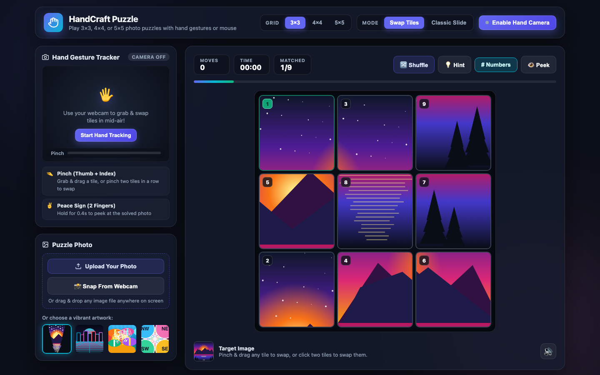

**2-Line Build Prompt:**
```text
Build a gesture-controlled photo puzzle web app using MediaPipe Hands that tracks webcam hand landmarks in real time, allowing players to pinch thumb and index finger in mid-air to grab and swap puzzle tiles or hold a peace sign to peek at the target image.
Support 3x3, 4x4, and 5x5 grids, Swap and Classic Slide puzzle modes, custom photo uploads or live webcam snapshots, built-in vector artworks, and full mouse/touch support when the camera is off.
```

---

## 14. How Money Works — 60s Cartoon Explainer ([`how-money-works-explainer`](./how-money-works-explainer))

**Tech Stack:** `Python (Pillow + FFmpeg)` · `ElevenLabs v4 Narration` · `HTML5 Interactive Player`

**Short Description:**
A 60-second 1080p animated cartoon explainer video and interactive web storyboard player breaking down the history and mechanics of money across 8 chapters: Barter, Commodity Money, Early Banknotes, Fiat Currency, Fractional Reserve & Digital Banking, Inflation, Interest Rates, and Financial Velocity—complete with word-synced dynamic yellow subtitle highlights and chapter seek cards.

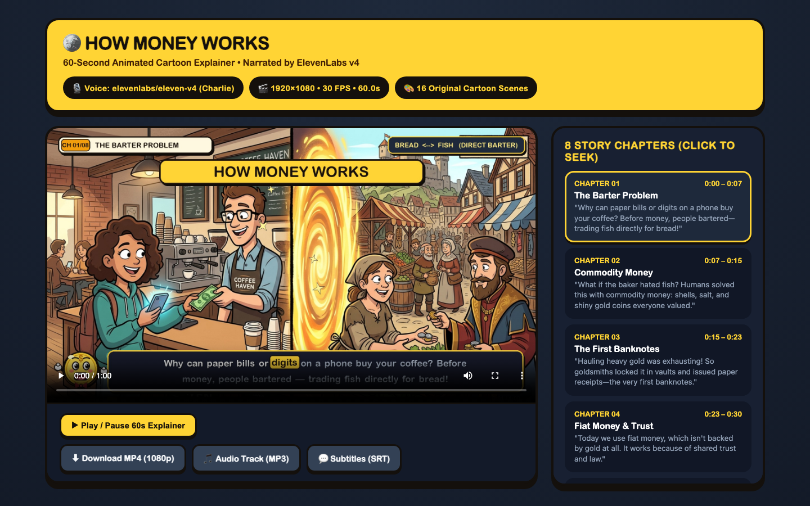

**2-Line Build Prompt:**
```text
Create a 60-second 1080p animated cartoon explainer on "How Money Works" covering 8 chapters from barter and gold coins to fiat currency, digital banking, and inflation, rendered with Python (Pillow/FFmpeg) and narrated with ElevenLabs voiceover.
Pair the rendered MP4, audio track, and SRT/VTT captions with an interactive web player featuring chapter-by-chapter seek cards and real-time word-highlighted subtitles.
```

---

## 15. What Is National Debt? — Whiteboard Explainer ([`national-debt-explainer`](./national-debt-explainer))

**Tech Stack:** `Python (Pillow + FFmpeg)` · `ElevenLabs v4 Narration` · `HTML5 Storyboard Player`

**Short Description:**
A 60-second Traditional Chinese financial explainer video (*小林說風格 · 60秒搞懂什麼是「國債」*) and interactive web player. Using a hand-drawn whiteboard animation aesthetic with red/green marker callouts and a live US Debt Clock ticker, it explains fiscal deficits, Treasury bonds as sovereign IOUs, the inverse bond price vs. yield seesaw, debt rollover (*借新還舊*), and the risks of money-printing inflation vs. productive GDP growth.


**2-Line Build Prompt:**
```text
Build a 60-second whiteboard-style animated video and interactive web player in Traditional Chinese explaining "What Is National Debt?" across 8 chapters—covering fiscal deficits, sovereign bond IOUs, the bond price/yield seesaw, and debt rollover.
Use a Python Pillow/FFmpeg rendering pipeline to composite 16 whiteboard storyboard scenes with animated marker arrows, a live debt clock, word-synced subtitles, and natural Chinese voiceover.
```

---

## 16. Panda Cycling in Kuala Lumpur ([`panda cycling`](./panda%20cycling))

**Tech Stack:** `SVG Animation` · `HTML5 / CSS3` · `Web Audio Bell Synthesizer`

**Short Description:**
A charming, self-contained animated SVG illustration of a giant panda wearing a cyan helmet and fluttering yellow scarf while pedaling a red bicycle down a Kuala Lumpur bike lane. The multi-layered parallax skyline features Merdeka 118, the Petronas Twin Towers, Menara KL Tower, the Sultan Abdul Samad clocktower, a gliding KL Monorail train, and interactive controls for time of day (Sunset, Day, Night), pedaling cadence (Chill, Cruise, Sprint), and a bicycle bell.

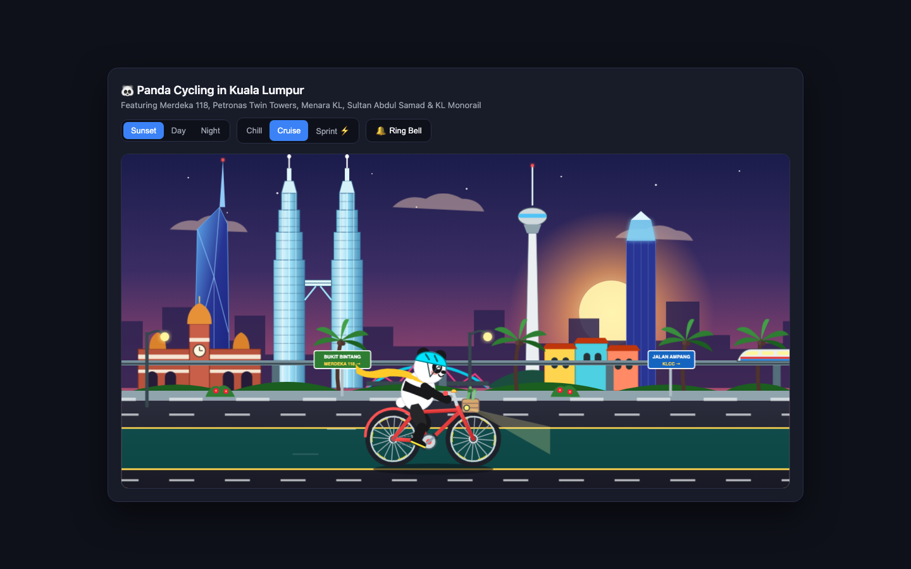

**2-Line Build Prompt:**
```text
Create a self-contained animated SVG web scene of a cute panda wearing a helmet and scarf riding a bicycle along a Kuala Lumpur street with parallax views of Merdeka 118, the Petronas Twin Towers, KL Tower, Sultan Abdul Samad Building, and a moving KL Monorail.
Add interactive controls to switch sky themes (Day, Sunset, Night), adjust cycling speed (Chill, Cruise, Sprint), and ring a synthesized bicycle bell with animated sound waves.
```

---

## 17. Galeri Proton — National Automotive Archive & 3D Museum ([`proton-museum`](./proton-museum))

**Tech Stack:** `React` · `TypeScript` · `Vite` · `Interactive 3D Isometric CAD Canvas`

**Short Description:**
An interactive curatorial archive and 3D isometric CAD engineering museum chronicling 42 years of Malaysian automotive history (1983–2025) across 18 milestone Proton vehicles—from the 1985 Shah Alam Proton Saga and Lotus-tuned Satria GTi to the Waja, Inspira, X50, and Cell-to-Body e.MAS 7 EV. Visitors can scrub the chronological timeline, inspect animated 3D wireframe/solid CAD models with exploded powertrain views, compare telemetry specs, and explore the Powertrain Lab.

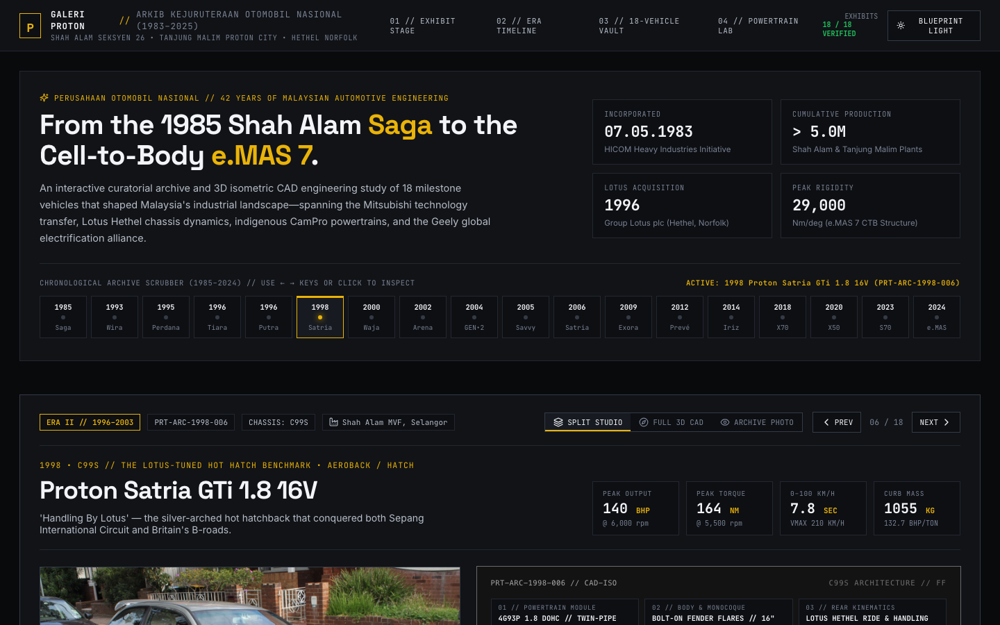

**2-Line Build Prompt:**
```text
Build an interactive digital museum and engineering archive ("Galeri Proton 1983–2025") in React and TypeScript showcasing 18 milestone Proton vehicles from the 1985 Saga and Satria GTi to the e.MAS 7 EV.
Include an interactive 3D isometric CAD viewport with exploded chassis/powertrain views, a chronological era scrubber, archival photography split-views, a powertrain engineering lab, and dark/blueprint theme switching.
```

---

## 18. ScreenStudio for macOS — Native Swift Screen Recorder ([`screen_recorder`](./screen_recorder))

**Tech Stack:** `Swift 5.9` · `SwiftUI` · `ScreenCaptureKit` · `AVFoundation` · `CoreImage`

**Short Description:**
A native macOS 14+ screen recorder and cinematic post-production editor inspired by Screen Studio. Built with `ScreenCaptureKit` and `AVFoundation`, it captures 60 FPS Retina display/window video alongside system audio, microphone narration, FaceTime webcam PiP, and global mouse-click telemetry (`NSEvent`), then automatically generates spring-smoothed cursor trajectories and editable auto-zoom timeline segments for 1080p/4K MP4/MOV export.

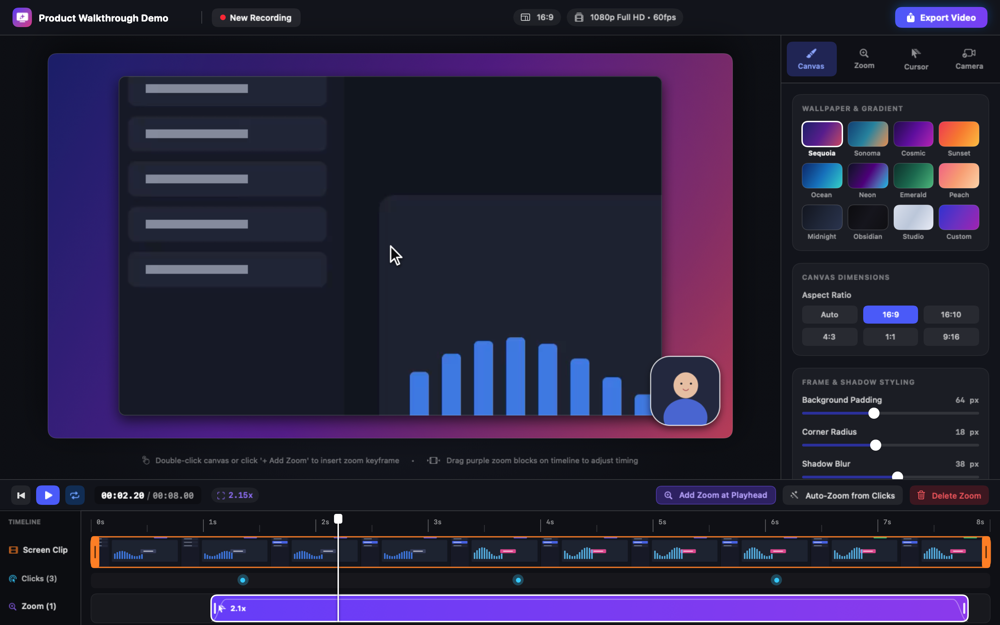

**2-Line Build Prompt:**
```text
Build a native macOS 14+ screen recorder and timeline video editor in Swift and SwiftUI using ScreenCaptureKit, AVFoundation, and CoreImage that captures 60 FPS screen video, webcam PiP, audio, and global mouse/click telemetry.
Implement a post-production studio with automatic click-triggered zoom keyframes, spring-smoothed cursor rendering, customizable macOS gradient wallpapers, window shadow/corner-radius controls, and hardware-accelerated MP4/MOV export.
```

---

## 19. SSStudio — Screen Studio Architecture Reconstruction ([`screenstudio-rea`](./screenstudio-rea))

**Tech Stack:** `React` · `TypeScript` · `Electron` · `HTML5 Canvas Compositor` · `Spring Physics Solver`

**Short Description:**
A functional desktop and web reconstruction of Screen Studio 4.0's architecture (`ssstudio`) built with React, TypeScript, and Electron. It implements a real-time 60 FPS Canvas stage compositor driven by an ODE harmonic spring solver (`stiffness` / `damping` / `mass` presets), multi-track timeline editing (Screen Clip, Auto-Zoom & Loupe keyframes, Camera Layout, Privacy Redaction Masks, Captions & AI Audio enhancement), an interactive click-to-zoom recorder simulator, and an architecture inspector modal.

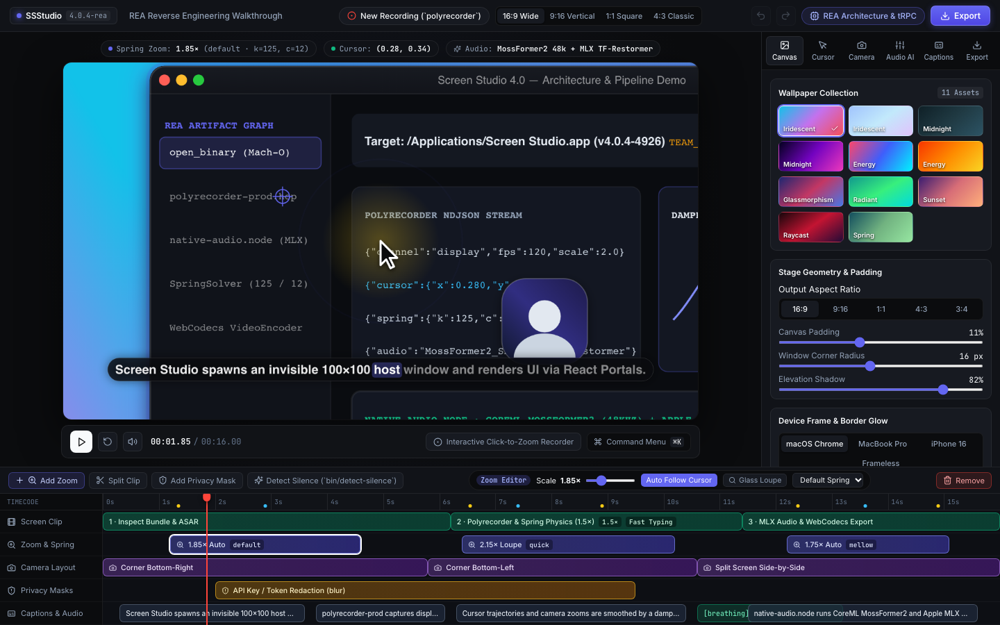

**2-Line Build Prompt:**
```text
Create a Screen Studio desktop and web video editor in React, TypeScript, and Electron featuring a 60 FPS HTML5 Canvas compositor with analytical spring-physics camera zooms, cursor smoothing, motion blur, and webcam PiP layouts.
Include a multi-track timeline editor for screen clips, auto-zoom blocks, privacy blur masks, and synchronized captions, plus an interactive live click-to-zoom recording mode and WebM/MP4 video export.
```

---

## 20. Moyun Shufa (墨韵) — Chinese Calligraphy Studio ([`shufa`](./shufa))

**Tech Stack:** `React 19` · `TypeScript` · `Vite` · `Hanzi Writer Data` · `HTML5 Canvas Ink Physics`

**Short Description:**
An interactive Chinese calligraphy stroke-order and brush-dynamics studio (*墨韵 · 中国书法笔意动画与章法研习馆*) supporting 9,500+ Simplified and Traditional characters. It renders authentic pressure-sensitive brush strokes with *feibai* (飞白 dry-brush) bristle textures across four script styles (*Kaishu*, *Xingshu*, *Feibai*, and *Rubbing*), multiple Xuan paper scroll layouts (horizontal plaque, traditional right-to-left handscroll, vertical hanging scroll), *Yongzi Bafa* (永字八法) eight-principle stroke anatomy breakdown, and an interactive freehand tracing studio.

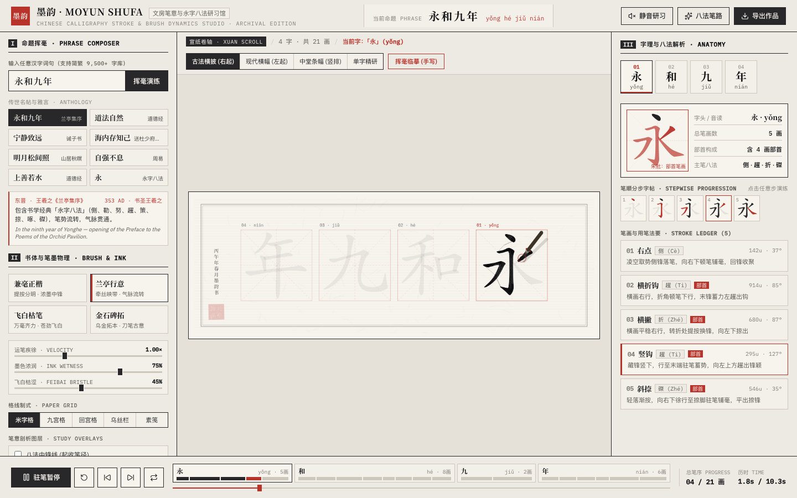

**2-Line Build Prompt:**
```text
Build an interactive Chinese calligraphy studio in React and TypeScript supporting 9,500+ characters with real-time HTML5 Canvas brush physics, adjustable ink wetness and feibai dry-brush textures, and traditional Xuan paper scroll layouts.
Include step-by-step stroke order progression, Yongzi Bafa (Eight Principles of Yong) stroke anatomy analysis, classical calligraphy anthology presets, and a freehand brush practice overlay with artwork export.
```

---

## 21. What Is GDP? ("Huge If True" Edition) ([`what-is-gdp`](./what-is-gdp))

**Tech Stack:** `Python (Pillow + FFmpeg)` · `ElevenLabs v4 Voiceover` · `Dual 16:9 & 9:16 Web Player`

**Short Description:**
A 60-second high-energy neon broadcast explainer video and interactive web studio inspired by Cleo Abram's *Huge If True*. It demystifies Gross Domestic Product ($110T+ global output), the $GDP = C + I + G + NX$ expenditure equation, Nominal vs. Real GDP inflation adjustment, and Simon Kuznets' warning on why GDP measures economic speed rather than human well-being—delivering both a 16:9 1080p studio broadcast cut and a 9:16 vertical short.

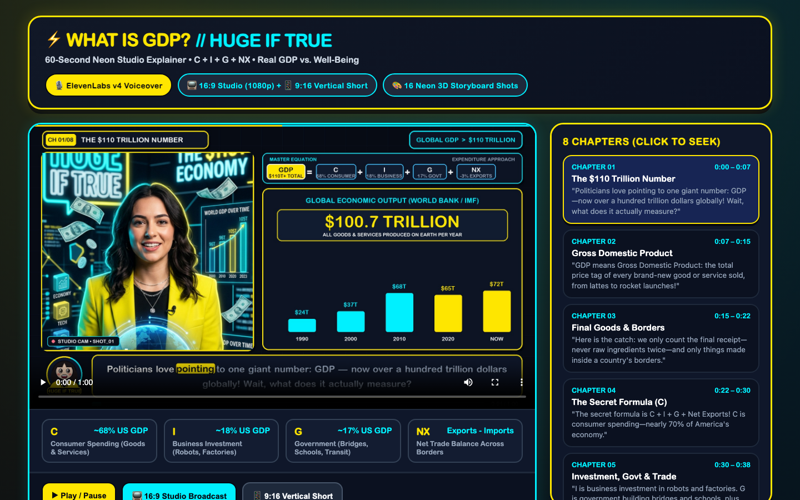

**2-Line Build Prompt:**
```text
Create a 60-second "Huge If True"-style neon studio explainer video and interactive web player on "What Is GDP?" breaking down the $110T global economy, the C + I + G + NX formula, Real vs. Nominal GDP, and GDP's limits as a well-being metric.
Render both a 16:9 1080p broadcast video and a 9:16 vertical short using Python (Pillow/FFmpeg) with animated data HUDs, word-synced yellow/cyan captions, and an 8-chapter interactive web switcher.
```
